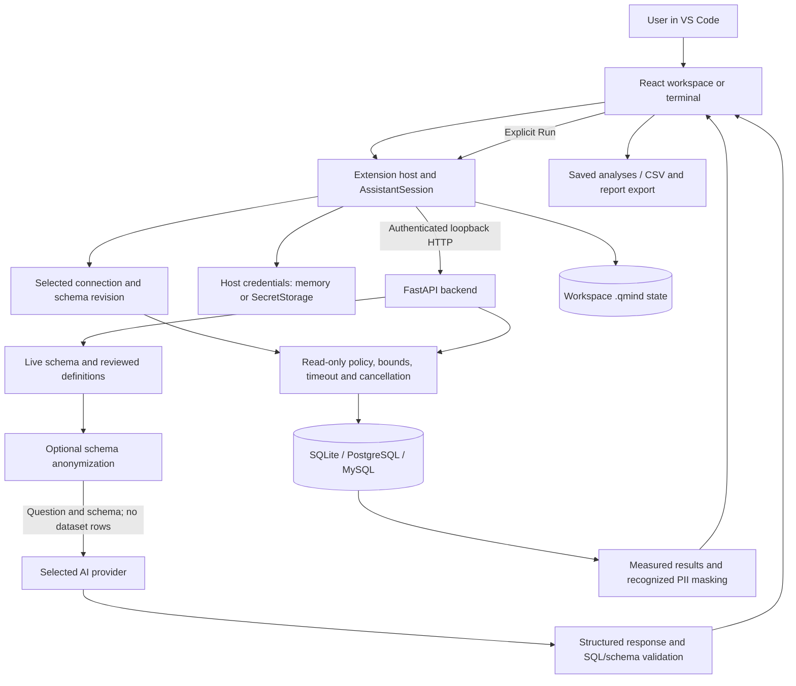

# Verbis architecture

Verbis is a local VS Code extension with a React workspace and Python FastAPI
backend. Users inspect data, generate or write SQL, review and run it, then
retain/export the measured analysis.

## Responsibilities

| Component | Responsibility | Main source |
|---|---|---|
| Activation/setup | Available commands, isolated Python install, readiness and bounded recovery | `src/extension.ts`, `src/BackendManager.ts`, `src/services/BackendInstaller.ts` |
| Interface | Five main pages, More tools, ordinary fields and visible errors/loading | `webview/src/App.tsx`, `webview/src/components/` |
| Message bridge | Single VS Code API, request ids, native dialogs and acknowledgements | `webview/src/vscode.ts`, `src/panels/VerbisPanel.ts` |
| Session | Bound SQL, follow-ups, credentials, cancel/reset, revision checks and history | `src/assistant/AssistantSession.ts` |
| AI | Provider-specific keys or ChatGPT browser OAuth, explicit model/attempt allowance | `SecretsService.ts`, `ChatGPTService.ts`, `python_backend/services/llm_service.py` |
| Grounding | Live schema, reviewed definitions, structured query/clarification and validation | `python_backend/api/routes/generate.py`, `services/validator_service.py` |
| Execution | AST and supported engine controls, named parameters, bounded fetch, timeout/cancel | `api/routes/execute.py`, `services/execution_service.py`, `core/db_pool.py` |
| Modules | CSV, saved analyses, static references, diagnostics, snapshot rehearsal/comparison | `api/routes/workspace.py`, corresponding backend services |
| Persistence | Workspace metadata/analyses/history/data; atomic stores and visible corruption errors | `WorkspaceService.ts`, `services/workspace_store.py` |

## Query paths

**With AI:** select database/provider, ask, receive SQL or a clarification, review
target/SQL/values, and choose Run. Schema validation checks structure; it cannot
prove that a model understood the intended business question.

**Without AI:** choose **Write SQL myself**. The actual selected schema binds a
new manual query to the database/revision. Type or paste SQL, review and Run.
The same execution policy applies; history records manual provenance. No model
response or provider allowance is involved.

## Boundaries

- The managed backend is loopback-only and authenticated with a per-process token.
- Keys/passwords use VS Code SecretStorage when available. Session keys and
  OAuth tokens remain in memory; ChatGPT registration identifiers persist
  separately. Reload requires signing in again.
- Cloud generation can anonymize identifiers in schema, question, definitions
  and previous SQL. Maps live for one request. Dataset rows are not generation
  context. User-typed text is still sent to the selected provider.
- Limited PII patterns/names are masked in results/previews; numeric amounts
  remain numeric. This is not a complete sensitive-data detector.
- `.qmind/` may contain SQL, definitions, connection metadata and imported data;
  it is excluded from Git/packages. Synthetic generated databases are also excluded.
- Exports retain executed SQL, values, definitions and measured rows, and
  neutralize spreadsheet formulas in CSV strings. Users choose export paths.

## Deliberate limits

The schema index is lexical. Code navigation is static Python/SQLAlchemy/SQL
evidence. Forensics covers bounded simple cases. Rehearsal supports SQLite
ADD/RENAME COLUMN on a temporary backup with SQL checks, not arbitrary migrations
or application execution. Comparison uses explicit keys/units and guarded review
proposals, not guessed entity matches or automatic production repair. Legacy
impact predictions are labelled estimates. These are documented support limits,
not a requirement to complete every original roadmap expansion.
