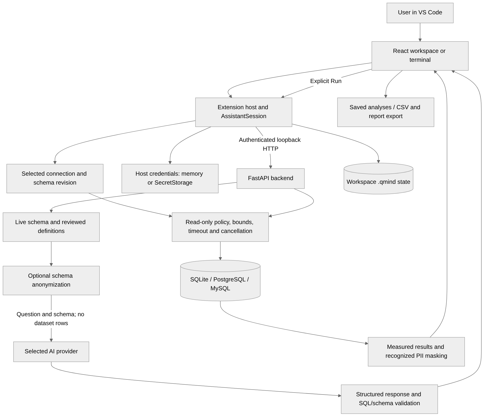

# Verbis — Intelligent Database Assistant

## Abstract

Verbis is a VS Code extension for schema-aware SQL generation and analysis. A
React workspace, TypeScript extension host and local Python backend provide a
complete connect/import → question → SQL review → execution → save/export
workflow. Users can also write SQL without AI. Business definitions and limited
diagnostic/change-review tools support investigation beyond query generation.

## Problem and objective

A model response alone does not establish the right schema, connection, safe
execution or useful result. Verbis aims to make those parts explicit and
recoverable in a developer's editor. The college scope prioritizes dependable
supported workflows over more providers, document types or frameworks.

## Implementation

- TypeScript: commands, sidebar, native dialogs, credentials/sessions, persistence
  and authenticated backend communication.
- React: five primary pages, descriptive extra tools and ordinary value/mapping
  fields with loading/error states.
- FastAPI/SQLAlchemy: schema introspection, provider generation, execution, CSV
  profiling, analysis and diagnostic services.
- SQLGlot: parsing, read-only checks, schema validation and supported diagnostic
  queries, alongside supported native database controls.
- Storage: workspace `.qmind/`, managed SQLite imports and VS Code SecretStorage
  or session-only credentials. No real key belongs in source or demo fixtures.

See [the architecture and data flow](ARCHITECTURE.md).

## Implemented capabilities

1. SQLite/PostgreSQL/MySQL connections, common selection, live validation and
   separately tested TLS support.
2. Schema-grounded generation/clarification, follow-ups and reviewed definitions,
   plus a manual SQL path that consumes no AI allowance.
3. Deliberate execution, read-only default, named values, revision checks, bounds,
   timeout and cancellation.
4. CSV preview/import with explicit format/unit rules, issue reports, keys/FKs,
   transactional policies and repeatable refresh.
5. Paginated measured rows, suitable aggregate charts, saved parameterized
   analyses, history and executed-snapshot CSV/readable report export.
6. Static Python/SQLAlchemy references, basic result explanations, isolated SQLite
   add/rename rehearsal and explicit SQL/CSV comparison/correction preview.
7. Backend setup/recovery, request-scoped anonymization, recognized PII masking,
   provider isolation and ChatGPT browser sign-in.

Integration does not establish successful inference for every provider/account.
See [the audit](COLLEGE-READINESS-AUDIT.md) for support and verification boundaries.

## Reproducible evaluation

The synthetic fixture has five employees with monthly INR salaries 7500, 8000,
8001, 12000 and NULL, two departments, and payment rows exposing join expansion.
A small application source includes known read/write and unresolved dynamic paths.

The standard-library verifier executes seven reviewed SQL examples read-only,
checks exact approved answers, independently computes threshold/department
results from CSV and checks source database bytes remain unchanged. A regression
test changes `>` to `>=`: the equality row must reveal the error. These are
deterministic pipeline checks, not evidence that AI generated those queries.

| Scenario | Expected result |
|---|---|
| Salary > 8000 | Cara (8001), Dev (12000); exclude equality and NULL |
| Keep threshold, only IT | Dev only |
| Salary = 8000 | Bob only |
| Missing salary | Esha only |
| Department payroll | Finance 8001; IT 27500 |
| Reviewed high earners > 9000 | Dev only |
| Salary joined to two Dev payments | 24000; diagnostics expose expansion |
| Rename salary on a snapshot | Old query fails afterward; source remains unchanged |
| Write in read-only mode | Rejected without deleting source rows |

Automated checks cover HTTP/services, safety, controlled extension/session and
credential behavior, exports, subprocess lifecycle and OAuth/JWT fixtures. Real
engines and installed VS Code checks are recorded separately. [The work
log](WORK-LOG.md) is the authoritative dated result record; earlier passes are
not relabelled as current tests.

## Deliverables and demonstration

Use [the five-minute guide](DEMO-GUIDE.md). Deliver the verified VSIX, source,
synthetic fixture/scripts, architecture, report and dated test evidence. The
manual SQL path is a no-quota fallback. Label manual/recorded demonstrations
accurately instead of presenting them as live AI.

## Limitations

Schema validation does not guarantee interpretation. Tests use synthetic data,
not the user's unknown employee dataset. Result limits can truncate data and
privacy detection is limited. OS keyring and Windows/macOS desktop acceptance
remain partly unverified. Browser login/model discovery alone does not prove
a completed ChatGPT response.

Code navigation does not understand arbitrary dynamic applications. Forensics
is not general query provenance. Rehearsal runs SQL, not application tests or
arbitrary migrations. Reconciliation needs explicit keys/units and does not read
scanned invoices or automatically repair the source. Static impact predictions
are simulations, not measured accuracy percentages.

## Scope conclusion

The project combines AI-assisted querying with explicit safety, repeatable data
preparation and reusable analysis. Submission readiness depends on the final
packaged demonstration and truthful evidence. Excel, PDF ingestion, more
frameworks, general migration testing and SQL Test Lab are outside the agreed scope.
